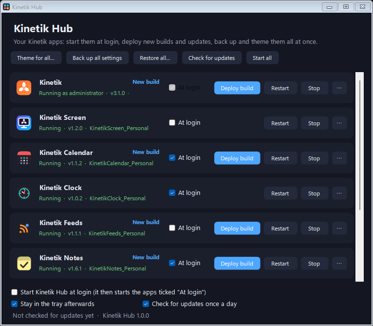

# Kinetik Hub: one place to run, update and theme the Kinetik apps

**Kinetik Hub** is a free, open-source tray app for Windows 11 and Windows 10 that looks after the other Kinetik apps: [Kinetik](https://github.com/WastedDesigner/Kinetik), Kinetik Screen, [Kinetik Calendar](https://github.com/WastedDesigner/KinetikCalendar), [Kinetik Clock](https://github.com/WastedDesigner/KinetikClock), [Kinetik Feeds](https://github.com/WastedDesigner/KinetikFeeds), [Kinetik Notes](https://github.com/WastedDesigner/KinetikNotes), Kinetik Weather, Kinetik Focus and Kinetik Dock.

> **About this project:** I made this for my own desktop and decided to share it in case anyone else finds it useful. If you run into a bug or have an idea for a feature, please open an issue.

## Features

- **Start at login:** tick "At login" for each app and Hub starts them one after another when you sign in. If an app already starts by itself, Hub can take that over. It keeps the app's own startup shortcut and puts it back if you untick the app.
- **Status at a glance:** for each app, whether it's running, its version and the folder it runs from. Start, restart or stop any of them from the window or the tray menu.
- **New builds:** when an app was rebuilt after it started, Hub offers **Restart now**. For Kinetik's bar, which runs from Program Files, **Deploy build** keeps the Program Files copy in `Old Versions` and puts the new build in place.
- **Updates from GitHub:** once a day (or when you ask), Hub checks each app's latest release, and its own. **Updates…** lists every app with the version installed and the latest on GitHub:
  - **Install** an app that isn't on this PC yet. It goes in its own folder beside the others (`Apps\<App folder>\<App>\`).
  - **Update** one app, or **Update all** at once. Running apps restart, and each replaced version is kept in Old Versions.
  - **Versions…** shows every release with its notes, to update to it or go back to an older one.
  - **Skip** a version you don't want; it isn't offered again until a newer one comes out.
  - **Install updates automatically** (off by default) installs new versions of the companion apps as soon as they're found. Kinetik Stats (administrator prompt) and Hub itself still ask first.
  - **Hub updates itself**: it puts the new version in place, keeps the old one in Old Versions, and restarts.
  - A build of your own that's newer than GitHub's latest is left alone.
- **Back up all settings** into one `.reg` file, and restore them all from it. Running apps are stopped first so they can't save over the restored settings.
- **Theme for all:** pick one theme, and a background opacity, and Hub sets them in every app that has one, restarting the ones that are running.
- **Suite settings:** one window for the settings every app shares: theme, background opacity, size, font, placement, lock position, click-through and snapping. Tick the ones to change and Hub applies them to all the apps at once.
- **Kinetik Stats** runs as administrator, so Hub restarts, updates and deploys it through an administrator prompt. Its own logon task keeps starting it.

## Where it looks for the apps

Hub expects one folder per app, the layout it lives in itself: `<Apps>\<App folder>\<App>\<App>.exe`, with the app's source and settings backup beside the exe and earlier exes in `<Apps>\<App folder>\Old Versions`. Each app's `build.bat` builds under a temporary name and moves the exe it replaces into `Old Versions`, so you can rebuild while the app runs. Hub then shows **New build: restart to use it**. It also finds apps that are running, apps that start from the Startup folder or the Run key, and the older layout with a separate `<App>_Personal` copy. For anything else, use **⋯ → Locate the exe…**.

## Download and use

1. Download `KinetikHub.zip` from Releases and extract it next to your other Kinetik apps.
2. Run `KinetikHub.exe`, tick **Start Kinetik Hub at login**, and tick **At login** for the apps you want.

Settings are kept in `HKCU\Software\KinetikHub`. The only network requests are to GitHub's API (and release downloads) when it checks for updates, which you can turn off.

## Requirements

Windows 10 or 11 (64-bit) with .NET Framework 4.8, which ships with both.

## Building from source

No SDK needed: `build.bat` compiles `KinetikHub.cs` with the .NET Framework compiler that ships with Windows. `build.bat package` also makes `KinetikHub.zip` for a release.

`KinetikHub.exe --demo` runs a separate copy that saves no settings, `--shot file.png` draws its window into a PNG and quits, and `--report file.txt` writes what Hub finds for each app (where it is, its working build, how it starts) without changing anything.

## Tests and packaging

`python tests/run-tests.py` runs the regression checks (no window opens). `build.bat package` builds the exe and makes the release zip, checking every file in it against its SHA-256 hash. The shared support code (`SuiteSupport.cs`) is compiled into the exe, so there's no extra DLL.

**Updates:** Hub installs a release only when it can check it, by GitHub's SHA-256 digest of the zip or by the exe's SHA-256 in the release notes. Older releases without either have to be installed by hand. Without signing in, GitHub allows 60 update checks an hour; a full check uses one per app, and Hub says when the limit is reached and when it resets. Hub closes an app by asking it to shut down; an app too old to answer has to be closed from its own tray menu first.

## License

[GPL-3.0-or-later](LICENSE). Copyright © 2026 Akila Sella Hennedige.
